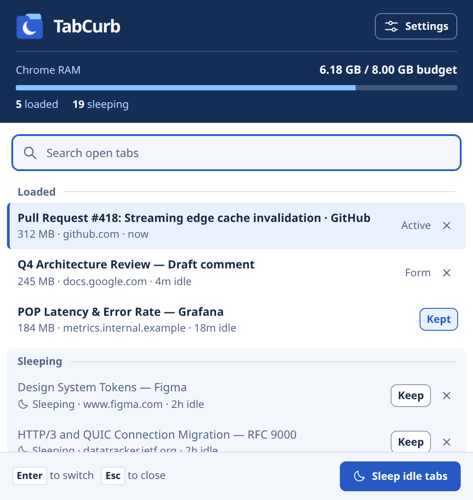
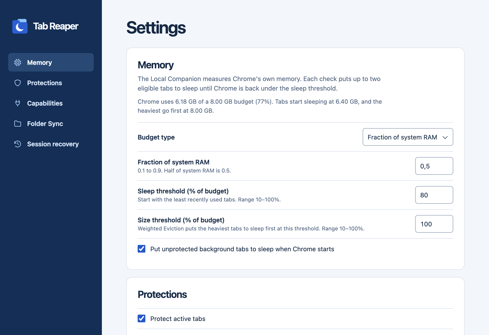

<p align="center">
  
</p>

<h1 align="center">Tab Reaper</h1>

<p align="center">
  Keep Chrome fast and bounded in RAM. Tab Reaper enforces a memory-banded RAM budget (<code>RAM / 2</code> by default), discards background tabs on startup, provides a keyboard-first open-tabs palette, and backs up sessions via optional Folder Sync.
</p>

<p align="center">
  Everything runs locally on your machine. No accounts, no telemetry. Only an optional daily check to GitHub Releases notifies you of new versions. See <a href="PRIVACY.md">PRIVACY.md</a>.
</p>

## Preview

<table>
  <tr>
    <td width="38%" valign="top">
      
    </td>
    <td width="62%" valign="top">
      
    </td>
  </tr>
</table>

## Install

Tab Reaper is installed with a guided one-command installer that sets up both the Chrome extension and the Local Companion in a permanent app folder (never `Downloads` or `/tmp`), verifies SHA-256 checksums, registers your Extension ID automatically, copies the folder path to your clipboard, and offers to open Chrome and the extension folder for you.

### 1. Run the installer

- **macOS / Linux (Terminal):**
  ```bash
  curl -fsSL https://raw.githubusercontent.com/marcusgrando/tab-reaper/main/install.sh | bash
  ```
- **Windows (PowerShell):**
  ```powershell
  irm https://raw.githubusercontent.com/marcusgrando/tab-reaper/main/install.ps1 | iex
  ```

For non-interactive installs, pass `--yes` on macOS/Linux (`curl -fsSL https://raw.githubusercontent.com/marcusgrando/tab-reaper/main/install.sh | bash -s -- --yes`) or `-Yes` on Windows (`& ([scriptblock]::Create((irm https://raw.githubusercontent.com/marcusgrando/tab-reaper/main/install.ps1))) -Yes`).

### 2. Load the extension in Chrome (one-time)

When the installer finishes, press **Enter** to open Chrome at `chrome://extensions` and the folder containing `extension`:

1. Turn on **Developer mode** (top right of `chrome://extensions`).
2. Drag the `extension` folder onto the `chrome://extensions` page, or click **Load unpacked** and paste the path already copied to your clipboard (`Cmd+Shift+G` then `Cmd+V` on macOS, `Ctrl+V` on Windows/Linux).
3. Tab Reaper Settings opens automatically with a **Quick setup** card. Click **Connect** to enable the pre-registered Local Companion, optionally enable **Weighted Eviction**, and pick a cloud folder for **Folder Sync** in one click.

### Update and Uninstall

- **Update:** Re-run the same install command above, then click the **Reload** icon on the Tab Reaper card in `chrome://extensions`.
- **Uninstall (macOS / Linux):**
  ```bash
  curl -fsSL https://raw.githubusercontent.com/marcusgrando/tab-reaper/main/install.sh | bash -s -- --uninstall
  ```
- **Uninstall (Windows PowerShell):**
  ```powershell
  & ([scriptblock]::Create((irm https://raw.githubusercontent.com/marcusgrando/tab-reaper/main/install.ps1))) -Uninstall
  ```
  Then click **Remove** on the Tab Reaper card in `chrome://extensions`.
- **Manual ZIP (extension only, no Local Companion):** Download `tab-reaper-extension.zip` from the [latest GitHub Release](https://github.com/marcusgrando/tab-reaper/releases/latest), unzip to a permanent folder, and load via `chrome://extensions` -> **Developer mode** -> **Load unpacked**.

### Why not the Chrome Web Store?

The Chrome Web Store installs only the extension package. Chrome does not allow an extension to install, register, or execute a local binary on its own.

Two core parts of Tab Reaper require the Local Companion (`tab-reaper-host`):

- **Exact Chrome & Per-Tab RAM:** Chrome extensions have no API to read Chrome's or individual tabs' real memory usage. They can only see system-wide free RAM and main-thread JS heap. The Local Companion reads Chrome's actual OS process memory (`phys_footprint` on macOS, PSS/RSS on Linux, Working Set and per-renderer Private Bytes on Windows) and attributes each renderer process to its open tabs.
- **Automatic Folder Sync:** Chrome revokes background write access for browser-picked folders after a restart. The Local Companion writes conflict-free session snapshots directly to your iCloud Drive, Google Drive, OneDrive, Dropbox, or Syncthing folder in the background without an external server or cloud account.

Installing from the Chrome Web Store would still require running a separate terminal command afterwards to install and register the companion. Installing with the guided script keeps both pieces in a single step and pre-registers the Extension ID automatically. The trade-off is that Developer mode must stay enabled in Chrome and updates require re-running the installer and clicking Reload.

## How Memory-Banded Eviction Works

Tab Reaper requests a memory check every 30 seconds and checks again when you open or switch tabs. How it decides depends on whether the optional Local Companion is installed. Settings shows only the options that apply, with the current numbers.

### With the Local Companion: a Chrome RAM budget

The companion measures Chrome's own memory. The default budget is half your system RAM.

- **Below the sleep threshold (default 80%).** Memory checks leave tabs loaded.
- **At or above the sleep threshold.** Each check puts up to two eligible tabs to sleep, starting with the least recently used. There is no minimum idle time.
- **At or above the size threshold (default 100%).** The heaviest tabs go first using real per-tab OS renderer memory from the Local Companion (prioritizing tabs whose renderer is not shared with a protected tab), or fallback page heuristics when page access is enabled without the companion. As usage drops below the size threshold, checks resume least-recently-used order until usage falls below the sleep threshold or all remaining tabs are protected. Both thresholds are configurable.
- **Chrome startup:** Non-protected background tabs are discarded immediately on startup (`startupSweep`, enabled by default).

### Without the Local Companion: system memory pressure

A Chrome extension cannot read Chrome's own memory, so Tab Reaper reacts to how much memory the computer has free. There is no budget to set.

| System | Least recently used first | Heaviest first |
| --- | --- | --- |
| Windows | 1000 MB free or less | 400 MB free or less |
| macOS | 800 MB free or less | 400 MB free or less |
| Linux | 10% of RAM free or less | 5% of RAM or 200 MB free or less |
| ChromeOS | Off. ChromeOS discards tabs under pressure itself. | Off |

Each check still puts at most two tabs to sleep. When other apps hold the memory, sleeping tabs may not help, so after four tabs sleep without freeing memory Tab Reaper waits until the pressure ends. Tabs still sleep on Chrome startup.

Tab Reaper protects active, audible, pinned, kept, and allowlisted tabs by default. With Weighted Eviction page access and form protection enabled, the palette shows `Form` after an observed edit. A title or filter filled in by the page leaves the tab eligible for sleep. Protection clears when the field returns to its value before the edit, whether you undo the change or the app empties the field after sending, as chat and e-mail apps do. An app that saves silently or replaces the edited field can keep the tab protected until reload.

## Optional Capabilities

- **Exact Chrome & Per-Tab RAM:** Measures exact Chrome and per-tab renderer memory (PSS/RSS on Linux, `phys_footprint` on macOS, Working Set and per-renderer Private Bytes on Windows) instead of OS-wide RAM or JS heap alone. Pre-installed by the installer above. If you installed via manual ZIP, copy the one-liner shown in Tab Reaper **Settings** -> **System** -> **Local Companion**.
- **Weighted Eviction & Page Protections:** In **Settings** -> **Memory**, toggle **Sleep heaviest tabs first (Weighted Eviction)** to discard heavier tabs first at the size threshold (default `100%`) using exact per-tab OS memory from the Local Companion, or fallback page heuristics (JS heap, DOM size, and media elements) when the companion is not installed. Optional page access under **Settings** -> **Protections** also protects unsaved form edits, active screen sharing, and Picture-in-Picture, and revokes automatically when turned off.
- **Active upload detection (off by default):** In **Settings** -> **Protections**, toggle **Protect tabs with active uploads** to pause sleeping while a tab has an active HTTP upload (`POST`/`PUT`/`PATCH` file, multipart, binary, or chunked transfer) and during brief 20-second gaps between chunks. The palette shows `Upload` while protected. Turning it off revokes `webRequest` access automatically. Off by default because Chrome's `webRequest` filter cannot restrict by HTTP method and wakes the extension on background XHR/fetch traffic. Uploads sent from Service Workers, WebSockets, or WebRTC cannot be detected automatically (use `Keep` or **Protected sites** for those).
- **Folder Sync & Session Snapshots:** Choose any local or cloud-synced directory (iCloud Drive, Google Drive, OneDrive, Dropbox, Syncthing) in **Settings** -> **Folder Sync** to sync session snapshots (`snapshots/`, `index.json`, `index-parts/`) and settings (`config-v2.json`). The budget type and the fixed GB budget stay on each computer. Session snapshots (automatic periodic captures, window-close recovery, pre-restore safety snapshots, and manual saves) are active only when Folder Sync is configured. The automatic snapshot interval is configurable from `1` to `1440` minutes (default `5` minutes). Your device name defaults to and follows the computer's hostname automatically, and can be overridden in Settings.

## Shortcuts

- `Alt+Shift+K` (`Option+Shift+K` on macOS): Open the Tab Reaper open-tabs palette (configurable at `chrome://extensions/shortcuts`).

## Development

Requirements: [Bun](https://bun.sh) and [Rust](https://rustup.rs) (only needed to build the native host from source).

```bash
bun install
bun run typecheck
bun test
bun run build        # outputs unpacked extension to dist/
bun run package      # creates dist/tab-reaper-extension.zip
bun run test:rust    # runs native-host unit tests
bun x playwright-core install chromium --no-shell  # once for the UI test
bun run test:ui      # tests the unpacked extension in Chromium
```

To build and install the native host locally from source:

```bash
./native-host/install.sh --from-source <chrome-extension-id>
```

On Windows PowerShell:

```powershell
.\native-host\install.ps1 -FromSource <chrome-extension-id>
```

## License

[MIT](LICENSE)
